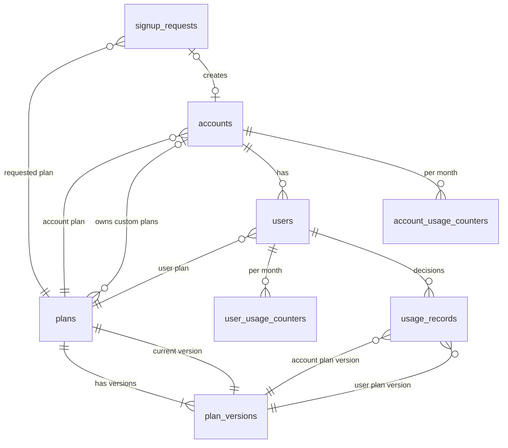

# Database design

PostgreSQL 17, schema created by the migrations in
[`backend/src/Infrastructure/Database/migrations`](../backend/src/Infrastructure/Database/migrations)
(applied in order at API start-up, each in its own transaction, recorded in `schema_migrations`).

## Tables

| Table | One row is | Key | Notes |
|---|---|---|---|
| `plans` | a plan (predefined or one account's custom plan) | `id` | `scope` = account or user; custom names unique per owner |
| `plan_versions` | one immutable revision of a plan's limits | `id`; unique `(plan_id, version)` | rows are only inserted, so old decisions keep the limits that applied |
| `accounts` | a company (tenant) | `id`; unique `api_key_hash` | only the SHA-256 of the API key is stored |
| `users` | an end user of a company | `id`; unique `(account_id, external_user_id)` | |
| `account_usage_counters` | units an account consumed in one UTC month | `(account_id, period)` | locked with `SELECT … FOR UPDATE` on every consume |
| `user_usage_counters` | units a user consumed in one UTC month | `(user_id, period)` | same |
| `usage_records` | one consume request and its decision (accepted or rejected) | `id`; unique `(account_id, request_id)` | also the idempotency record |
| `signup_requests` | a self-service request for an account | `id` | only the hash of the claim code is stored |

Units are `bigint` (never floating point), months are `date` (first day, UTC), timestamps are
`timestamptz`. Every text column has a length check.

## Normal form

Every table is in **third normal form** for its stored facts: each non-key column depends on the
whole key and on nothing but the key. Lookups that would repeat data (plan names, account names,
current limits) are joins, never copies.

A handful of columns repeat information on purpose. Each one exists for concurrency,
idempotency or index-only reads, and **each is tied to its source by a constraint**, so it cannot
drift (migration `004_integrity_constraints.sql`):

| Repeated column | Why it is stored | What keeps it correct |
|---|---|---|
| `usage_records.account_id` (also implied by `user_id`) | scopes idempotency (`UNIQUE (account_id, request_id)`) and the per-account history indexes | composite FK `(user_id, account_id)` → `users (id, account_id)` |
| `usage_records.period` (also implied by `created_at`) | month-based indexes and filters | `CHECK (period = date_trunc('month', created_at AT TIME ZONE 'UTC'))` |
| `plans.current_version_id` (the latest version) | one-join reads of the limits in force | composite FK `(current_version_id, id)` → `plan_versions (id, plan_id)`: it must be one of the plan's own versions |
| `plans.is_predefined` (also implied by `owner_account_id IS NULL`) | readable filters | `CHECK (is_predefined = (owner_account_id IS NULL))` |
| `accounts.plan_scope`, `users.plan_scope`, `signup_requests.requested_plan_scope` (constants) | let a foreign key check the plan's scope | `FK (plan_id, plan_scope)` → `plans (id, scope)` + `CHECK (scope = 'account' / 'user')` |
| `account_usage_counters`, `user_usage_counters` (sums of accepted `usage_records`) | the row lock that serializes concurrent consumes for one account / user | updated in the same transaction as the record; a test compares them with the records |

What is **not** repeated: snapshots that are history, not duplication. `usage_records` keeps the
plan **version** ids, the counters after the decision and the list of failed rules (`violations`,
`jsonb`) exactly as they were when the decision was made. Plans change later; the record must not.
`rejection_rule` / `rejection_level` hold the first failure as columns so history can be filtered
in SQL; a CHECK keeps them consistent with `outcome`. `signup_requests.company_name` is what the
applicant typed; the account created on approval may later be renamed.

## Constraints that encode business rules

- Predefined plans have no owner, custom plans exactly one; names are unique per owner (case-insensitive).
- A plan used by an account must be an account plan, and by a user a user plan (scope foreign keys).
- Limits: `monthly_allowance >= 0`, `max_units_per_request > 0`, counters `>= 0`, units requested `> 0`.
- One decision per `(account, requestId)`; a rejected record always names its rule and level.
- A sign-up request is `pending` (no decision, no account), `approved` (with decision time and
  account) or `rejected` (decision time, no account); a key can only be claimed after approval.
  One open request per email (case-insensitive), one account per request.
- Stored secrets are hashes: `api_key_hash` and `claim_code_hash` must be 64 hex characters, and
  `api_key_prefix` must be the 13-character display prefix, so a raw key cannot be stored by mistake.

## Indexes

Chosen from the queries the API runs (all lists are keyset-stable: `created_at DESC, id DESC`):

| Index | Serves |
|---|---|
| `usage_records (account_id, created_at DESC, id DESC)` | account history, latest request of an account |
| `usage_records (account_id, period, created_at DESC, id DESC)` | account history and counts for one month |
| `usage_records (user_id, created_at DESC, id DESC)` | user history, latest request of a user |
| `usage_records (user_id, period)` | per-user request counts for a month (users directory) |
| `usage_records (created_at DESC, id DESC)`, `(period)` | cross-account history and monthly totals |
| `account_usage_counters (period)` | operator totals for a month |
| `accounts (created_at DESC, id DESC)`, `accounts (plan_id)`, `users (plan_id)` | lists and plan facets |
| `signup_requests (status, submitted_at DESC, id DESC)`, `(submitted_at DESC, id DESC)` | access requests list |

Every foreign key used for lookups is the leading column of an index (unique constraints create
one). Plan-version foreign keys on `usage_records` have no index on purpose: plan versions are
never deleted, so the index would only slow down every insert.

## Concurrency

The consume path runs in one transaction: advisory lock on `(account, requestId)` → idempotency
lookup → `SELECT … FOR UPDATE` on the account counter, then the user counter (always in that
order, so two requests cannot deadlock each other) → evaluate → update both counters → insert the
record. Deadlocks and serialization failures are retried a bounded number of times. The
concurrency tests (`npm run test:concurrency`) prove that limits hold under parallel requests.
